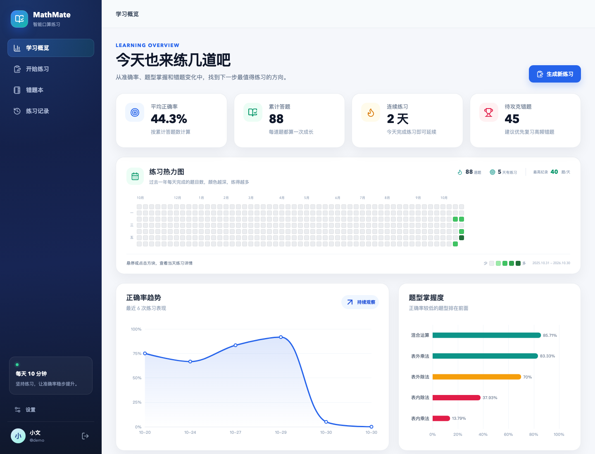
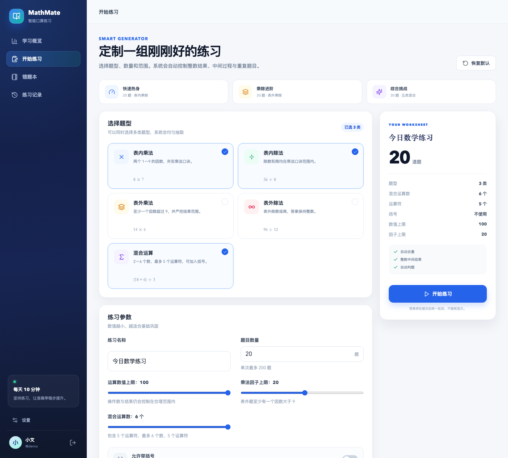
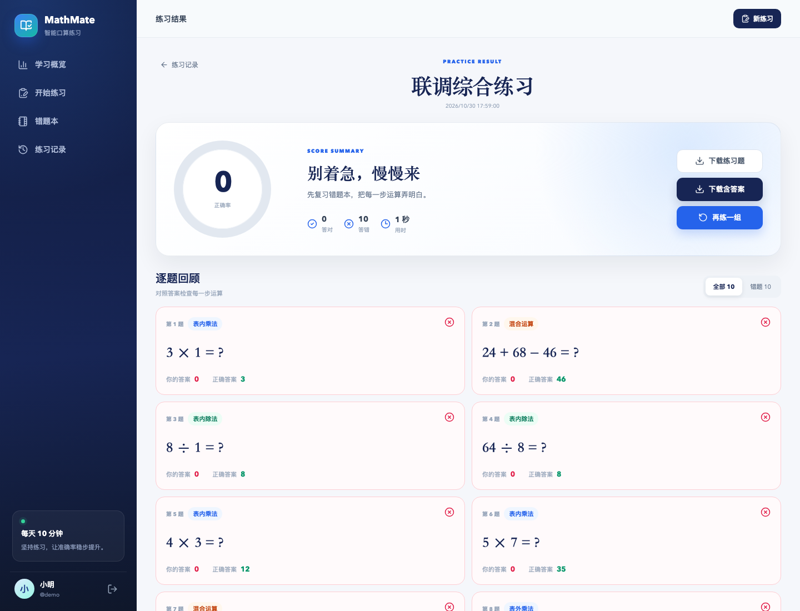
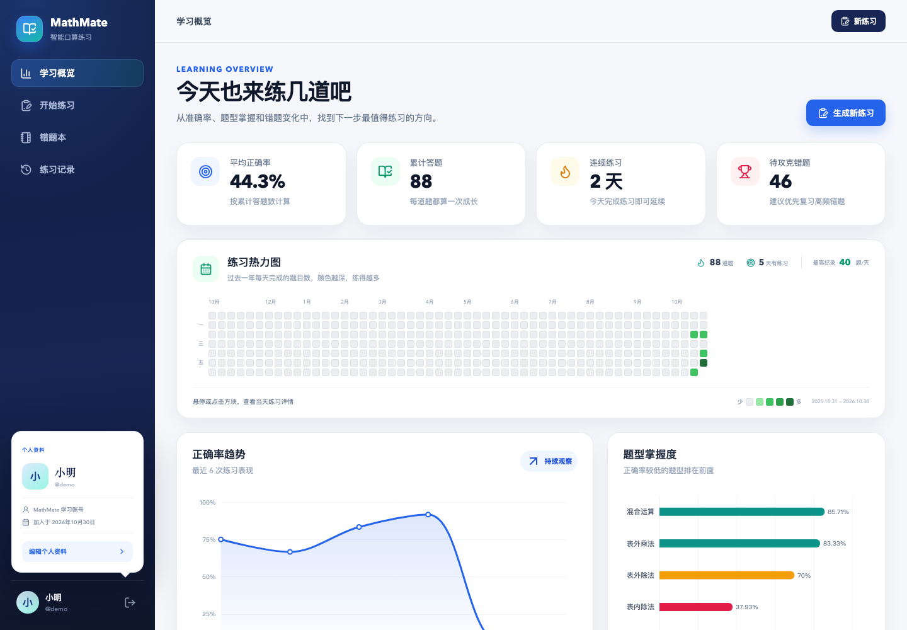

# 作业3：MathMate 智能数学练习平台

> 本目录是 Advanced-SE 课程作业3。项目采用 Vue 3 + TypeScript 前端、Spring Boot + MyBatis 后端、MySQL 数据库，以及可选的 Python FastAPI Agent。

## 密钥与本地配置说明

仓库**不包含任何真实密钥**。首次运行前请按下面步骤创建本地配置：

```bash
cd assignments/assignment-03

# DeepSeek Agent 配置
cp agent-service/.env.example agent-service/.env

# 阿里云 OSS 配置（若需要使用 OSS 头像上传）
cp scripts/oss.env.example scripts/oss.env
```

然后编辑 `agent-service/.env`：

```env
DEEPSEEK_API_KEY=填写自己密钥
DEEPSEEK_BASE_URL=https://api.deepseek.com
DEEPSEEK_MODEL=deepseek-chat
```

编辑 `scripts/oss.env`：

```env
OSS_ENABLED=true
OSS_ENDPOINT=填写自己的OSS Endpoint
OSS_BUCKET=填写自己的Bucket名称
OSS_ACCESS_KEY_ID=填写自己的AccessKey ID
OSS_ACCESS_KEY_SECRET=填写自己的AccessKey Secret
OSS_PUBLIC_BASE_URL=填写自己的Bucket公网地址
```

`.env` 和 `scripts/oss.env` 已被 `.gitignore` 排除，请勿提交真实密钥。没有配置 DeepSeek 时，周报会自动使用模板回退；没有配置 OSS 时，头像使用本地上传。

一个前后端分离的完整四则运算学习产品。支持智能出题、在线答题、自动判题、错题本、学习趋势分析和中文 PDF 练习卷导出。

## 已实现功能

### 出题与练习

- 表内乘法：两个 1～9 的因数
- 表内除法：除数、商均在乘法口诀范围内
- 表外乘法：至少一个因数大于 9
- 表外除法：表外除数或商，结果保持整数
- 混合运算：通过滑动条选择 2～6 个数，对应 1～5 个运算符，最多 6 个数、5 个运算符
- 可切换是否允许括号
- 每一步中间结果必须为 0～100 的整数，除法必须整除且不能除 0
- 可设置题目数量（1～300）
- 可设置数值上限和乘法因子上限
- 自动去重，包括加法/乘法的交换、结合等价题
- 每道题保存题型标签，并在答题页、结果页、PDF 和题型统计中统一使用
- 自动控制中间结果与最终结果为 0～100 的整数
- 自动避免除以 0、分数和小数

### 学习闭环

- 用户注册、登录和 JWT 身份认证
- 在线逐题作答、答题卡跳转、计时
- 提交后自动判题，展示逐题解析
- 错题自动进入错题本，并记录对应题型
- 支持选择多道错题后“原题重做”或“按题型生成同类练习”
- 同类练习会自动排除错题原题，并按所选错题题型比例分配题量
- 同一错题连续答对两次自动标记为“已掌握”
- 学习概览：累计答题、正确率、连续天数、待攻克错题
- 正确率趋势、题型掌握度图表，使用 ECharts
- GitHub 风格年度练习热力图：按每日题量着色，悬停/点击查看当天详情
- 独立设置页：昵称可直接修改，登录密码修改需要当前密码验证
- 支持本地上传头像；配置 OSS 后自动切换为浏览器直传 OSS
- 点击左下角用户信息可查看个人资料浮层，设置页专门用于编辑资料与账号安全
- 练习记录分页查看
- PDF 练习卷导出：可导出空白卷或含答案卷，保留中文宋体和彩色排版
- 学习周报：每周题量、学习时长、正确率环比、每日节奏、薄弱题型和高频错题
- 一键推荐练习：按薄弱题型自动分配题量（默认最薄弱 60%、第二薄弱 40%）
- DeepSeek Agent：只将结构化 `WeeklyFacts` 改写成中文总结，不参与成绩计算或推荐决策
- Agent 失败回退：未配置 Key、超时、非法 JSON 或内容审核失败时自动使用确定性模板
- `agent_runs` 记录模型、耗时、调用状态、审核状态和错误信息
- 每周一 00:05 自动生成上一周周报

### 默认演示数据

首次启动会自动创建演示账号，并生成最近几天的历史练习、趋势数据与错题：

```text
用户名：demo
密码：demo123
```

## 产品预览










OSS 配置说明：[docs/ALIYUN_OSS_SETUP.md](docs/ALIYUN_OSS_SETUP.md)


实际 PDF 样例：[今日数学练习_含答案_题型标签.pdf](samples/今日数学练习_含答案_题型标签.pdf)

## 技术栈

| 层 | 技术 |
| --- | --- |
| 前端 | Vue 3、TypeScript、Vite、Pinia、Vue Router |
| 图表 | ECharts 5 |
| PDF | html2canvas + jsPDF（浏览器端生成，保证中文显示与 A4 分页） |
| 后端 | Spring Boot 3.3、Java 17、MyBatis |
| 安全 | Spring Security、JWT、BCrypt |
| 数据库 | MySQL 8+ |
| Agent | Python 3.12、FastAPI、OpenAI SDK、DeepSeek OpenAI 兼容接口 |
| 构建 | Maven、npm |

## 目录结构

```text
assignment-03/
├── backend/                  Spring Boot 后端
│   ├── src/main/java/
│   │   └── com/mathmate/
│   │       ├── config/       安全、演示数据初始化
│   │       ├── controller/   REST API
│   │       ├── dto/          请求与响应模型
│   │       ├── entity/       数据库实体
│   │       ├── mapper/       MyBatis Mapper
│   │       ├── security/     JWT 认证
│   │       └── service/      出题、判题、统计业务
│   ├── src/main/resources/
│   │   ├── mappers/          MyBatis XML
│   │   ├── application.yml
│   │   └── schema.sql
│   └── pom.xml
├── frontend/                 Vue 3 前端
│   └── src/
│       ├── api/
│       ├── components/
│       ├── layouts/
│       ├── router/
│       ├── stores/
│       ├── styles/
│       ├── types/
│       └── views/
├── agent-service/            确定性周报文案 Agent（FastAPI）
│   ├── app/
│   ├── tests/
│   ├── requirements.txt
│   └── .env.example
├── db/init.sql               创建数据库和用户
├── db/migration_v4_weekly_reports.sql
├── scripts/setup-db.sh
├── scripts/setup-agent.sh
├── scripts/dev.sh
└── docker-compose.yml
```

## 启动方式一：本机 MySQL

### 1. 安装依赖

需要 Java 17、Maven、Node.js 18+、MySQL 8+。

macOS 如果没有 Maven/MySQL：

```bash
brew install maven mysql
```

前端依赖：

```bash
cd assignments/assignment-03/frontend
npm install
```

> 本机已经检测到 `/usr/local/mysql/bin/mysqld` 和 IntelliJ 自带 Maven，脚本会自动发现它们，无需额外配置 PATH。

### 2. 启动 MySQL

```bash
cd assignments/assignment-03
bash scripts/start-mysql.sh
```

如果本机已经有 MySQL 在 3306 端口运行，脚本会自动复用。

### 3. 初始化数据库

```bash
bash scripts/setup-db.sh
```

脚本会创建：

```text
数据库：mathmate
用户名：mathmate
密码：mathmate
```

### 4. 安装并配置周报 Agent（可选）

```bash
cd assignments/assignment-03
bash scripts/setup-agent.sh
```

先运行 `cp agent-service/.env.example agent-service/.env`，再编辑 `agent-service/.env`：

```env
DEEPSEEK_API_KEY=填写自己密钥
DEEPSEEK_BASE_URL=https://api.deepseek.com
DEEPSEEK_MODEL=deepseek-chat
```

如果暂不填写 Key，模板回退仍可完整使用周报功能。

### 5. 一键启动前后端与 Agent

```bash
bash scripts/dev.sh
```

访问：<http://localhost:5173> 或 <http://127.0.0.1:5173>

后端地址：<http://localhost:8080>

Agent 健康检查：<http://127.0.0.1:8000/health>

也可以分别启动：

```bash
cd backend && mvn spring-boot:run
cd frontend && npm run dev
```

## 启动方式二：Docker MySQL

如果本机已安装 Docker：

```bash
cd assignments/assignment-03
docker compose up -d
```

然后按上面的方式启动后端和前端即可。

## 环境变量

后端默认配置见 `backend/src/main/resources/application.yml`，也可以覆盖：

```bash
export DB_URL='jdbc:mysql://localhost:3306/mathmate?useUnicode=true&characterEncoding=utf8&serverTimezone=Asia/Shanghai&allowPublicKeyRetrieval=true&useSSL=false'
export DB_USERNAME='mathmate'
export DB_PASSWORD='mathmate'
export JWT_SECRET='请替换为至少 32 字节的随机密钥'
export CORS_ALLOWED_ORIGINS='http://localhost:5173,http://127.0.0.1:5173'
export DEMO_ENABLED='true'
```

前端如需连接其他后端地址：

```bash
export VITE_API_BASE_URL='http://localhost:8080/api'
```

## 核心 API

| 方法 | 路径 | 说明 |
| --- | --- | --- |
| POST | `/api/auth/register` | 注册 |
| POST | `/api/auth/login` | 登录 |
| GET | `/api/auth/me` | 当前用户 |
| POST | `/api/practice/sessions` | 按配置生成并开始练习 |
| GET | `/api/practice/sessions/{id}` | 获取练习详情 |
| POST | `/api/practice/sessions/{id}/submit` | 提交并自动判题 |
| GET | `/api/practice/sessions` | 练习记录分页 |
| GET | `/api/wrong-book` | 错题本分页 |
| PATCH | `/api/wrong-book/{id}/mastered` | 标记错题掌握状态 |
| POST | `/api/wrong-book/practice` | 原题重做或按题型生成同类练习 |
| GET | `/api/stats/dashboard` | 学习统计与趋势 |
| GET | `/api/settings/avatar/config` | 查询头像存储模式 |
| POST | `/api/settings/avatar/presign` | 获取 OSS 直传预签名 URL |
| POST | `/api/settings/avatar/confirm` | 确认 OSS 头像并保存 URL |
| POST | `/api/settings/avatar/local` | 本地头像上传回退 |

除登录、注册和健康检查外，接口均需要请求头：

```text
Authorization: Bearer <token>
```

## 数据库表

- `users`：用户账号
- `practice_sessions`：每次练习及成绩
- `practice_questions`：逐题记录、用户答案、正确答案
- `wrong_questions`：错题本、题型标签、错误次数、连续答对次数
- `weekly_reports`：每周指标快照、总结、推荐配置和已读时间
- `agent_runs`：模型调用状态、耗时、内容审核状态与错误信息

`backend/src/main/resources/schema.sql` 会在后端启动时自动执行 `CREATE TABLE IF NOT EXISTS`。

已有数据库可以运行 `bash scripts/setup-db.sh` 自动补齐错题题型、头像和周报表结构。

## 出题合法性

出题引擎按题型分别生成候选，并使用规范化键去重。混合运算通过逆运算构造每一步操作数，从源头保证：

1. 每题恰好三个数、两个运算符；
2. 每一步中间结果和最终结果均为整数；
3. 所有结果落在 0～100；
4. 除法一定整除且除数不为 0；
5. 需要改变运算顺序时自动补括号；
6. 题目在单次练习内不重复。

后端还包含 `QuestionGeneratorServiceTest`，用于验证批量出题数量和去重约束。

## 构建与测试

前端类型检查和生产构建：

```bash
cd assignments/assignment-03/frontend
npm run build
```

后端测试：

```bash
cd assignments/assignment-03/backend
mvn test
```

后端打包：

```bash
mvn clean package
java -jar target/mathmate-backend-1.0.0.jar
```

Agent 测试：

```bash
cd assignments/assignment-03/agent-service
.venv/bin/python -m pytest -q
```

## 周报与 Agent 设计

1. `WeeklyMetricsService` 只统计已提交练习，按题量加权计算正确率。
2. 薄弱题型至少需要 3 道样本；推荐练习由 Java 确定性分配题量。
3. Java 将脱敏后的 `WeeklyFacts` 传给 FastAPI Agent。
4. DeepSeek 只返回严格的 `summary/highlights/suggestions` JSON。
5. Python 做结构校验和基础内容审核，Java 再做二次校验。
6. 任意环节失败都会回退到模板，不阻断周报生成。
7. 每次模型调用写入 `agent_runs`，便于后续审计、统计成本和排查故障。
